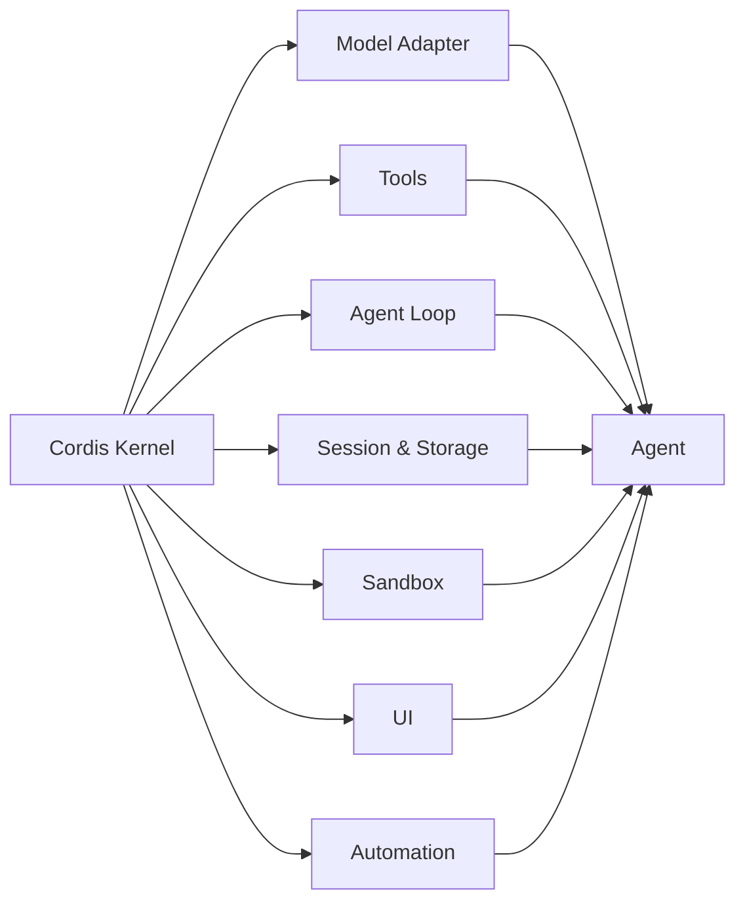

# DeepSeek Harness：当 Agent 开始相信「一切皆插件」

最近 DeepSeek Harness 挺火的，最抓眼球的一句话就是：**Everything is a Plugin，一切皆插件。**

说实话，我第一次看到这句话时，反应有点像看到“一切皆文件”或者“一切皆对象”——听起来很酷，但也很容易变成一句漂亮口号。插件嘛，IDE 有插件，浏览器有插件，很多 AI 工具也早就能装插件了，它到底新在哪里？

翻完官方介绍和架构文档后，我觉得它真正有意思的地方不是“可以装插件”，而是：**它尝试把 Agent 本身也拆成插件。**

这两者差别很大。

## 先说清楚：Harness 到底是什么

官方给出了一个很简洁的表达：

```text
Agent = Model + Harness
```

模型负责理解、推理和生成，Harness 则负责把模型接到真实世界里。读取文件、执行命令、调用工具、保存会话、控制权限、管理上下文、安排下一轮循环，这些让模型真正“做事”的部分，都属于 Harness。

换句话说，同一个模型接上不同的 Harness，最终表现出来的能力可能完全不同。模型像大脑，而 Harness 更像身体、工具箱、工作环境和行动规则的总和。

以前聊 Agent，大家很容易只盯着模型参数和榜单。DeepSeek Harness 提醒了一个越来越明显的事实：模型当然重要，但真正决定 Agent 能不能稳定干活的，往往是模型外面的那一整套工程系统。

## “一切皆插件”不是多装几个工具

在 DeepSeek Harness 里，插件的范围比一般理解要大得多。模型适配器、工具、Skills、会话、存储、沙箱、调度、UI，甚至 Agent Loop 都可以由插件提供。

它底层使用 Cordis。Cordis 内核本身尽量保持克制，主要处理插件的加载、卸载、依赖关系、服务和事件。真正的 Agent 能力被放在一个个插件中，再通过共享上下文协作。



这意味着系统里没有一个必须不断修改的“万能核心”。想增加能力时，更推荐在旁边挂载一个新插件；插件卸载时，它注册的服务、事件和副作用也应当一起撤销。

我觉得这才是“一切皆插件”真正大胆的地方：**不是给固定产品加扩展，而是把产品本身变成一次插件组合的结果。**

## 为什么这种设计会让人兴奋

### 1. Agent 不再只有一种固定形态

传统 Agent 框架通常会替开发者决定很多事情：使用哪种循环、会话怎么存、工具怎么注册、上下文如何拼接。简单场景下，这样开箱即用很舒服；可一旦想改底层行为，就可能需要 Fork 框架或者绕过它。

DeepSeek Harness 通过 Profile、Bundle 和配置补丁来组合插件树。同一套基础能力，可以组装成带完整 Web UI 的 Agent、无界面的 Headless Agent、SDK 服务，或者只保留少量工具的极简运行时。

对开发者来说，这更像搭积木：不是每次都从零造轮子，但也不用被某一种官方组合锁死。

### 2. 替换能力的成本更低

假设我不满意默认沙箱，想把命令执行迁移到远程容器；或者想更换模型供应商、会话存储和子 Agent 实现。如果这些模块都依赖稳定的服务接口，替换 Provider 就能影响整个系统，而不需要同时改 Agent Loop、工具和 UI。

这种“能力接缝”很像后端开发里常见的依赖倒置：消费者依赖接口，具体实现可以切换。概念并不陌生，只是 DeepSeek Harness 把它贯彻到了 Agent 运行时的更多层级。

### 3. 插件可以组合，而不只是并排存在

插件体系最怕的情况是：看起来装了很多扩展，实际上每个扩展都是孤岛。

Cordis 提供共享服务、类型化事件和生命周期管理，让插件之间可以围绕同一上下文协作。例如，一个插件负责模型适配，一个插件负责工具执行，另一个插件监听调用事件并记录遥测。它们各自关心自己的职责，但最后共同构成一条完整链路。

```text
用户输入
  → 会话插件记录事件
  → Prompt 与工具描述组装
  → 模型适配器发起请求
  → Agent Loop 驱动工具调用
  → 沙箱执行命令
  → 监控插件记录轨迹
  → 结果再次写回会话
```

从工程角度看，这比把所有逻辑塞进一个巨大的 Agent 类里舒服多了。

## Plugin、Tool、Skill 和 MCP 不是一回事

这几个词现在经常混在一起，简单区分一下：

| 概念 | 更接近什么 | 主要作用 |
| --- | --- | --- |
| Plugin | 运行时模块 | 注册服务、事件、工具、界面或底层能力 |
| Tool | 模型可调用的函数 | 让模型执行搜索、读写文件、运行命令等操作 |
| Skill | 可复用的任务经验 | 告诉 Agent 面对特定任务时应如何工作 |
| MCP | 外部能力连接协议 | 以统一方式接入外部工具、服务和数据源 |

一个插件可以注册 Tool，也可以加载 Skill，或者连接 MCP 服务。但它们并不是同义词。

我更愿意把 Plugin 理解成“装配单位”：它不仅能给模型一把新锤子，还能改变工具如何执行、会话如何保存、界面如何显示，甚至循环如何继续。

## 灵活不是免费的

“一切皆插件”听起来很自由，但自由的另一面通常是复杂度。

### 依赖关系会变得更难理解

当一个 Agent 是几十个插件组合出来的，排查问题时就不能只看一份主流程代码。启动顺序、依赖注入、事件优先级、配置覆盖和卸载行为，都会成为调试的一部分。

### 兼容性仍然是现实问题

DeepSeek Harness 目前还是开发者预览版，官方明确提醒核心插件和 API 会快速迭代，并可能出现破坏性变更。现在适合体验、学习和做原型，但如果要直接承载稳定生产业务，版本固定、回归测试和升级策略一个都不能少。

### 插件越强，安全边界越重要

当插件可以接触文件、Shell、凭据、会话和 UI 时，它已经不只是一个小扩展，而是一段拥有真实权限的程序。安装社区插件前，至少要确认来源、检查权限和代码，并尽量先在隔离环境运行。

插件生态的上限取决于开放程度，下限则取决于权限治理。这一点可能比插件数量更重要。

## 哪些场景值得试试

我觉得 DeepSeek Harness 比较适合下面几类需求：

- 想研究 Agent Loop、上下文、工具和会话如何协作，而不满足于只调一个 API；
- 需要在本地、远程沙箱、Web、Headless 或 SDK 之间复用能力；
- 想替换模型、存储或执行环境，并保留其余系统结构；
- 正在做自己的 Agent 产品，希望建立可持续扩展的插件生态；
- 想快速验证一个新工具、新 UI 面板或新的自动化流程。

如果只是做一个固定流程的小机器人，直接使用更轻量的 SDK 可能反而更省事。不是所有项目都需要把每个部件拆成插件，架构的价值最终还是要看变化是否真的频繁。

## 快速体验

按照官方说明，安装 Node.js 后可以直接启动 Web UI：

```bash
npx @deepseek-ai/dsh web
```

如果要阅读源码或参与开发，可以克隆官方仓库：

```bash
git clone https://github.com/deepseek-ai/deepseek-harness.git
cd deepseek-harness
pnpm install
pnpm run build
pnpm dsh web
```

目前项目迭代很快。我更建议先在测试目录体验默认组合，再去看配置树和插件机制，不要一上来就把重要工作区、密钥和生产服务全接进去。

## 我的看法

DeepSeek Harness 最吸引我的，不是它又提供了一个聊天窗口或者编码 Agent，而是它把一个问题摆到了台面上：**未来的 Agent，究竟应该是一个功能越来越多的完整产品，还是一个可以随任务重新组合的运行时？**

“一切皆插件”未必会成为唯一答案，但它提供了一种很有工程味的思路。模型更新很快，工具和业务也一直在变，与其不停重写一个越来越臃肿的核心，不如把变化关进边界明确、可以替换的模块里。

当然，插件化不是魔法。接口设计不好，最后还是会变成一堆互相依赖的包；生态治理跟不上，也可能出现兼容性和安全问题。但如果 Cordis 的组合方式能够经受住真实项目考验，DeepSeek Harness 的意义可能不只是“又一个 Agent 框架”，而是让更多人开始认真讨论 Harness 本身。

这大概也是我觉得它值得关注的原因：大家终于不只是在卷模型，也开始卷怎么让模型更可靠地工作了。

## 参考资料

- [DeepSeek Harness 官方介绍](https://deepseek.com/harness/)
- [DeepSeek Harness GitHub 仓库](https://github.com/deepseek-ai/deepseek-harness)
- [DeepSeek Harness Architecture](https://github.com/deepseek-ai/deepseek-harness/blob/master/docs/architecture.md)
- [Cordis: A Programming Paradigm for Spatiotemporal Composability](https://arxiv.org/abs/2608.25512)
