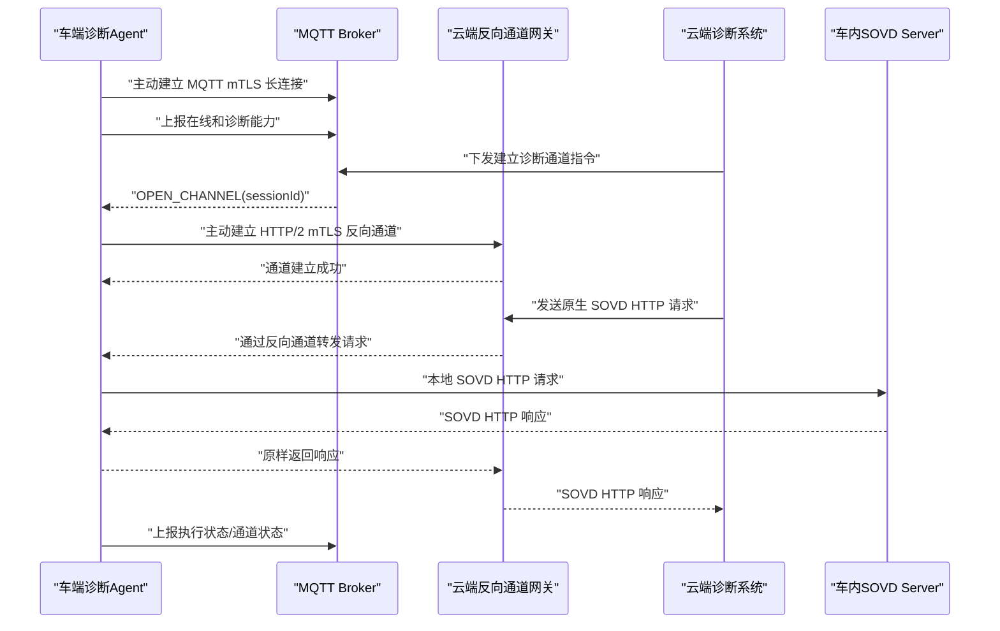
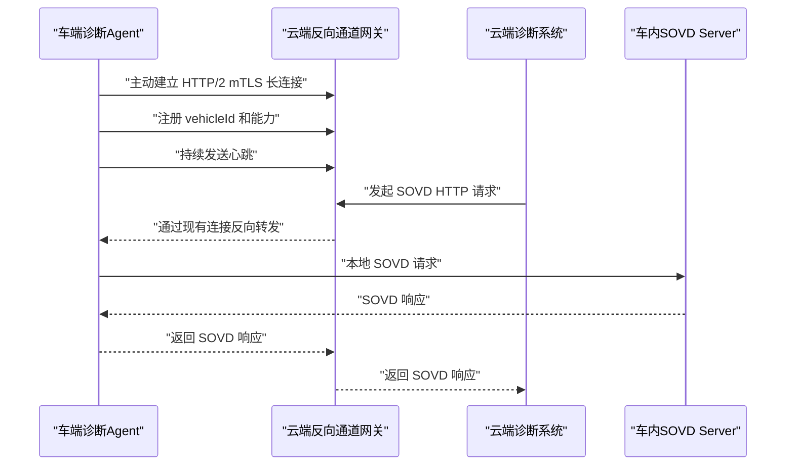

# MQTT＋HTTP 还是仅 HTTP：SOVD 车云连接方案对比

可以把两者理解为：

- **方案一：MQTT 负责找车和调度，HTTP/2 反向通道负责传输 SOVD。**
- **仅 HTTP 反向通道：HTTP/2 长连接同时负责车辆在线、任务调度和 SOVD 传输。**

## 方案对比

| 维度           | MQTT + HTTP反向通道      | 仅HTTP反向通道           |
| -------------- | ------------------------ | ------------------------ |
| 车辆在线连接   | MQTT长连接               | HTTP/2长连接             |
| 云端通知车辆   | MQTT下发建链指令         | 直接通过HTTP/2控制流     |
| SOVD诊断流量   | HTTP/2反向隧道           | HTTP/2反向隧道           |
| SOVD合规性     | 高                       | 高                       |
| MQTT使用程度   | 符合甲方“尽可能使用MQTT” | 不满足或弱满足           |
| 离线消息       | MQTT Broker天然支持      | 云端自行实现任务队列     |
| 在线状态       | MQTT遗嘱、会话机制较成熟 | 自行实现心跳和半连接检测 |
| 连接数量       | 通常两条                 | 一条                     |
| 系统复杂度     | 双协议及状态协调         | 反向HTTP网关复杂         |
| 弱网重连       | MQTT相对成熟             | 需要完整自研             |
| 大规模车辆接入 | MQTT Broker更成熟        | 依赖HTTP网关设计能力     |

## 方案一：MQTT控制面 + HTTP反向通道



建议 MQTT 负责：

- 车辆上线、下线和心跳。
- 唤醒诊断通道。
- 通道建立、关闭、异常状态通知。
- 诊断任务摘要和任务状态。
- 取消、超时等控制命令。
- 车辆离线期间的任务排队。

HTTP/2反向通道负责：

- 完整的 SOVD HTTP 请求和响应。
- 多个并发 SOVD 请求。
- 日志、配置、故障数据等响应。
- 大文件可以继续通过独立 HTTPS 上传。

该方案最适合当前要求：既保留甲方希望的 MQTT，又不需要把 SOVD HTTP 请求重新设计成 MQTT Payload。

## 仅使用HTTP反向通道

车辆启动后直接建立到云端的长期 HTTP/2 连接：



但这里不能使用普通的“车端发起一个HTTP请求并保持不返回”来完成所有功能。普通 HTTP 的客户端不能在一个空闲请求上任意接收云端发起的新 HTTP 请求，需要明确采用以下一种机制：

1. **HTTP/2双向流**

   车辆建立一个长期控制流，云端通过流发送诊断请求。实现类似 gRPC Bidirectional Streaming。

2. **HTTP/2 CONNECT反向隧道**

   车辆向云端建立隧道，云端通过隧道访问车内 SOVD Server。更适合保持原生 SOVD HTTP 语义。

3. **HTTP长轮询**

   车辆不断查询待执行任务。实现简单，但实时性、流量和并发能力都较差，不推荐作为主方案。

如果强调 SOVD 原生协议，优先使用 **HTTP/2反向隧道**，而不是把 SOVD 请求包装成自定义双向流消息。

## 两种方案中的SOVD合规性

两种方案都可以保持较高的 SOVD 合规性，前提是：

```
云端SOVD Client
    ↓ 标准SOVD HTTP请求
云端反向代理
    ↓ 透明隧道
车端反向代理
    ↓ 标准SOVD HTTP请求
车内SOVD Server
```

反向通道只解决网络可达性，不修改：

- SOVD URI。
- HTTP Method。
- Header。
- JSON结构。
- HTTP状态码。
- 错误响应。
- 异步操作和资源生命周期。
- Capability Discovery。
- OpenAPI描述。

这样可以将反向通道视为网络基础设施，而不是重新定义一种 SOVD API。

## 推荐选择

在甲方明确要求“尽可能使用MQTT”的情况下，建议选：

> **MQTT永久在线，HTTP/2反向诊断通道按需建立。**

推荐运行方式：

- MQTT随车端联网长期保持。
- 无诊断任务时，不建立HTTP反向通道。
- 云端通过MQTT发送`OPEN_CHANNEL`。
- 车辆检查点火状态、电量、网络和安全条件。
- 车辆主动建立HTTP/2 mTLS通道。
- 云端通过该通道发送原生SOVD请求。
- 诊断完成或空闲超时后关闭通道。
- MQTT继续保持在线。

只有在下列情况下才建议完全取消 MQTT、仅用 HTTP：

- 甲方不再坚持 MQTT。
- 车云平台没有现成 MQTT 基础设施。
- 诊断服务是车辆唯一的长连接业务。
- 乙方愿意自行实现在线状态、离线队列、心跳、重连、流量控制和连接路由。
- HTTP反向通道需要长期在线，而不是每次诊断临时建立。

因此，综合标准合规、甲方要求和工程风险，**方案一更合适；仅HTTP反向通道连接更少，但会把MQTT原本成熟解决的问题转移到乙方的HTTP网关中。**


如果没有甲方的 MQTT 硬性要求，且系统只服务于远程诊断，**优先选择“仅 HTTP/2 反向通道”**。它组件更少、协议边界更清楚，也更贴近 SOVD 的 HTTP/REST 技术体系。

不过，生产级大规模车队如果存在大量离线车辆、低功耗唤醒和通用车云消息需求，MQTT + HTTP 会更合适。

## 直接结论

| 场景                         | 推荐             |
| ---------------------------- | ---------------- |
| 只建设远程诊断系统           | 仅HTTP/2反向通道 |
| 快速完成原型或首期项目       | 仅HTTP/2反向通道 |
| 强调SOVD原生语义             | 仅HTTP/2反向通道 |
| 已有成熟车联网MQTT平台       | MQTT + HTTP      |
| 百万级车辆、经常离线         | MQTT + HTTP      |
| 除诊断外还有遥测、告警、控制 | MQTT + HTTP      |
| 需要车辆低功耗休眠及按需唤醒 | MQTT + HTTP      |

## 为什么仅HTTP更好实现

两种方案都需要实现HTTP反向通道。方案一还要额外建设：

- MQTT Broker。
- Topic和ACL体系。
- MQTT设备证书认证。
- MQTT与HTTP通道的状态协调。
- `OPEN_CHANNEL`重复投递和幂等。
- MQTT在线但HTTP通道失败等异常处理。
- 两套连接的监控、重连和运维。

因此，在没有既有MQTT平台的情况下：

```
MQTT + HTTP反向通道
= MQTT设备接入系统
+ HTTP反向通道系统
+ 两套系统之间的协调
```

而仅HTTP方案是：

```
HTTP反向通道
= 车辆连接管理
+ 反向请求路由
+ SOVD透明代理
```

组件和故障状态都更少。

## 推荐的纯HTTP架构

不是普通HTTP长轮询，而是车辆主动建立的 **HTTP/2 mTLS长连接/反向隧道**：


车辆联网后的过程：

1. 车辆主动与云端建立HTTP/2 mTLS连接。
2. 云端根据证书确定车辆身份。
3. 车辆注册`vehicleId`、SOVD版本和能力信息。
4. 云端维护`vehicleId → HTTP/2连接`映射。
5. 云端收到诊断请求后，通过该连接反向发送。
6. 车端转发给本地SOVD Server。
7. 响应通过原连接返回云端。

建议通道至少包含：

- 一条控制流：注册、心跳、能力、关闭原因。
- 多条诊断流：并发SOVD请求。
- 独立上传通道：日志、dump等大文件。
- Ping/心跳和半连接检测。
- 指数退避重连。
- 请求超时与取消。
- 最大并发流限制。
- 请求和响应流量限制。

## 纯HTTP方案的主要难点

它虽然组件更少，但反向通道本身需要认真设计。

### 1. 不能使用普通HTTP请求实现云端反向调用

普通模式是：

```
车端请求 → 云端响应
```

不能在普通空闲请求上让云端任意发起新的HTTP请求。应选择：

- HTTP/2 CONNECT反向隧道；或
- 基于HTTP/2的双向流协议。

为了尽可能透明地传输SOVD，优先考虑 **HTTP/2反向隧道**。

### 2. 车辆离线任务需要自己实现

纯HTTP没有MQTT Broker的持久消息机制，云端需要实现：

```
CREATED → WAITING_FOR_VEHICLE → DELIVERED → RUNNING → COMPLETED
```

同时设置：

- 任务有效期。
- 车辆重新上线后的投递策略。
- 幂等`requestId`。
- 取消和过期处理。
- 最大排队数量。

### 3. 网关需要支持长连接

需要确认云端负载均衡器和网关支持：

- HTTP/2长连接。
- CONNECT或双向流。
- 较长的空闲超时。
- 连接迁移或优雅摘流。
- 基于车辆身份的连接路由。
- 网关滚动升级时的连接排空。

这是纯HTTP方案最主要的工程风险。

## 什么时候MQTT + HTTP反而更合适

如果甲方已经有统一MQTT车云连接，增加MQTT并不意味着多建设一套系统。此时直接复用它会更简单：

- 在线状态已经存在。
- 车辆证书和身份体系已经存在。
- 离线消息和会话恢复已经存在。
- 车辆已经实现MQTT重连。
- 诊断只需要增加一个`OPEN_CHANNEL`指令。
- HTTP通道只在诊断期间建立。

这种情况下，MQTT + HTTP反而比保持永久HTTP诊断连接更经济。

## 最终建议

如果是从零建设、仅考虑诊断业务：

> **采用仅HTTP/2反向通道，SOVD请求透明传输；大文件也使用HTTPS。**

如果企业已经有车联网MQTT平台，或者未来平台还要承载遥测、告警、OTA、远程控制：

> **复用MQTT作为永久控制通道，SOVD诊断时按需建立HTTP/2反向通道。**

从乙方项目交付角度，我会把默认方案定为纯HTTP/2，同时在接口设计中预留MQTT唤醒能力，不在第一期同时建设两套链路。


