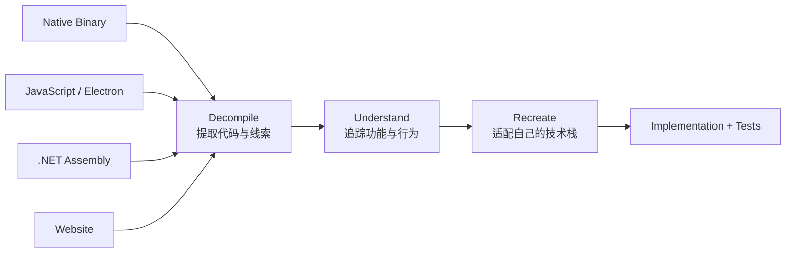

# REA 火了：软件壁垒正在一步步降低

最近 REA 这个项目挺火，全名也很直接：**Reverse Engineer Anything，逆向一切。**

看到这个名字，很容易产生一种科幻感：是不是把一个软件丢给 AI，等一会儿，源码和复刻版就都出来了？以后看到什么功能，直接让 Agent 拆开照着做，软件开发的门槛岂不是要被打穿？

我研究了一下，结论是：**它没有宣传语听起来那么无所不能，但它带来的变化依然很大。**

REA 真正厉害的地方，不是发明了新的反编译算法，而是把原本分散、专业、需要大量手工操作的逆向工具，接到了 Coding Agent 面前。以前要在反编译器、终端、文档和编辑器之间来回切换，现在可以直接用自然语言让 Agent 调查一个功能、整理证据，再尝试做出兼容实现。

这件事正在一步步降低软件的“理解壁垒”。

## REA 到底是什么

REA 是一个面向 AI Agent 的开源逆向工程工具集，同时提供 CLI 和 MCP 接口。它可以连接 Hopper、Ghidra 等分析引擎，也提供针对 JavaScript、Electron、.NET 和网站的分析能力。

它的基本思路可以概括为三步：



第一步是 **Decompile**。REA 调用底层工具，从程序中提取伪代码、汇编、字符串、符号、调用关系和元数据。

第二步是 **Understand**。Agent 围绕一个具体问题继续追踪，例如“搜索功能如何建立索引”“数据保存在哪里”“复制操作如何保留富文本格式”，并把不同位置的线索串起来。

第三步是 **Recreate**。Agent 根据调查结果，在你的项目里写出一个适合当前技术栈和需求的实现，再通过测试或行为对比验证结论。

这里有个非常重要的区别：REA 强调的是**理解和兼容重建**，不是保证恢复原始源码，更不是自动克隆完整应用。

## 它降低的到底是哪一道门槛

传统逆向工程真正难的地方，往往不只是“看不懂汇编”。更麻烦的是整个调查过程：

- 先判断程序类型和架构；
- 找到可能相关的字符串、符号或入口；
- 顺着引用和调用图定位关键函数；
- 在伪代码、汇编和运行时行为之间交叉验证；
- 记录哪些是事实、哪些只是推测；
- 最后把理解转换成能运行的新代码。

每一步都需要经验，而且上下文很容易断。一个地址、一条分支或一个不起眼的常量，可能要在几个工具之间追很久。

REA 把这些能力包装成 Agent 可以调用的工具。你问的是“这个功能怎么实现”，Agent 则在背后执行搜索字符串、查引用、看调用图、批量反编译、保存证据等操作。

换句话说，它把交互方式从：

```text
人学习工具 → 人手动调查 → 人整理线索 → 人重新实现
```

逐渐变成：

```text
人提出问题 → Agent 调用专业工具 → Agent 汇总证据 → 人审核并继续实现
```

专家知识当然没有消失，但很多机械操作、上下文搬运和初步分析可以交给 Agent。以前需要先学会“怎么操作工具”，现在可以更早进入“我到底想搞清楚什么”。

这就是我理解的软件壁垒下降：**不是所有人突然都会逆向了，而是专业能力开始被封装成自然语言可调用的基础设施。**

## 为什么 MCP 在这里很关键

REA 并不是把反编译结果一股脑塞给模型。它通过 MCP 暴露一组结构化能力，Agent 可以按问题逐步调用。

例如，要调查一个离线搜索功能，Agent 可能会依次完成：

1. 识别目标程序和二进制结构；
2. 搜索与 search、index、query 相关的字符串或过程；
3. 查找这些线索的交叉引用；
4. 构建局部调用图；
5. 反编译关键函数；
6. 整理证据、限制和未解决问题；
7. 在自己的项目中实现并测试相似行为。

模型负责制定调查路线和解释结果，Hopper、Ghidra 等工具负责提供底层观察，REA 则负责把两边连起来。

所以它更像一个“逆向工程 Harness”，而不是另一个反编译器。

## “逆向一切”仍然是一句口号

项目名字很有气势，但现实边界还是要讲清楚。

### 反编译不等于拿回源码

编译会丢失变量名、注释、目录结构和一部分高级语义。反编译器输出的是根据机器码推断出来的伪代码，不是开发者当初写下的原始代码。

Agent 可以帮助解释，但解释依然可能出错。REA 会记录证据、置信度和限制，这一点很重要，因为“看起来合理”不代表“已经证明”。

### 客户端里没有的东西，逆向也变不出来

如果核心逻辑完全运行在服务器端，本地客户端通常只能看到请求格式和响应行为，看不到后端源码、训练数据、内部规则和真实数据库。

同样，一个成熟产品的价值也不只存在于可执行文件里。数据积累、运营流程、品牌、渠道、用户关系、云服务和持续迭代能力，都不是反编译几段代码就能复制的。

### 混淆和保护仍然有效

代码混淆、符号剥离、加壳、反调试、自定义虚拟机和复杂的动态行为，都会增加分析难度。AI 可以加速一些步骤，但不会让这些问题凭空消失。

### 平台支持和工具链也有限制

REA 当前主要支持 macOS 和部分 Linux 环境，具体能力取决于目标类型及本机安装的分析引擎。原生二进制的深度分析仍需要 Hopper 或 Ghidra，部分平台能力还在完善中。

所以，“Anything”更适合理解为项目愿景，而不是一张保证书。

## 软件的护城河会转移

REA 最值得讨论的，不是“以后软件还能不能卖”，而是：**只靠实现细节保密建立的优势，还能维持多久？**

过去，一个桌面软件即使功能并不复杂，只要没有源码，理解它的文件格式、通信协议和业务流程就要付出很高成本。现在，Agent 可以带着工具持续追踪代码和行为，这部分成本正在下降。

我觉得未来的软件壁垒会越来越偏向下面这些东西：

| 旧壁垒 | 更难替代的新壁垒 |
| --- | --- |
| 实现细节不公开 | 持续迭代速度 |
| 私有文件格式 | 数据质量与生态 |
| 隐藏的交互逻辑 | 用户体验与品牌信任 |
| 客户端算法 | 服务能力与运营体系 |
| 信息不对称 | 合规、安全与长期维护 |

代码依然重要，但“别人看不懂我的代码”会越来越难成为长期优势。真正牢固的壁垒，会更多来自别人即使理解了原理，也很难复制的系统能力。

## 这项技术用在哪里最有价值

逆向工程不只等于破解软件。它有很多合理而且很实际的用途：

- 为自己拥有的软件补全文档；
- 理解无人维护的遗留系统；
- 迁移旧应用或旧数据格式；
- 构建兼容工具和互操作实现；
- 修复停产硬件的驱动或控制软件；
- 做经过授权的安全审计；
- 保存老游戏和数字文化作品；
- 验证程序是否存在异常行为。

这类工作以前常常卡在“没人敢碰，也没人看得懂”。REA 能让 Agent 先完成一轮有证据的调查，再由人决定下一步，价值其实很大。

## 但工具不是授权

能分析，不代表可以随便分析；能重建，也不代表可以直接复制和发布。

软件许可证、服务条款、著作权、商业秘密和当地法律都可能限制逆向工程。不同地区对互操作、研究、安全测试和合理使用的规定也不一样。使用前应确认自己拥有目标软件，或者已经获得明确授权。

至少要守住几条基本边界：

- 不绕过付费、授权、DRM 或访问控制；
- 不复制和传播专有代码、资源及用户数据；
- 不对不属于自己的系统进行未授权测试；
- 不把“研究用途”当成侵犯知识产权的万能理由；
- 发布兼容实现前，检查许可证和法律风险。

REA 默认在本地运行分析，但使用的 Agent 或模型服务可能有自己的数据策略。敏感程序、密钥和内部系统仍然要放在合适的隔离环境中。

## 如果想体验，先从小目标开始

官方推荐的安装入口是：

```bash
npx rea-agents setup
```

不过，我不建议第一次就拿一个复杂商业软件让它“全部逆向”。更稳妥的方式是选择自己编写的程序、开源项目的编译产物，或者官方示例，然后问一个足够具体的问题：

```text
找出这个程序如何导出 CSV，展示关键证据，
再用 TypeScript 实现一个兼容版本并编写测试。
```

问题越具体，调查路径越容易验证。先证明一个功能，再逐步扩大范围，比“把整个软件复制出来”靠谱得多。

## 我的看法

REA 让我最有感触的一点是，AI 正在把很多“只有少数专家会用的工具”变成“更多开发者可以调动的能力”。

这和低代码不太一样。低代码是把常见开发流程封装起来，而 REA 做的是把观察、追踪和理解现有软件的过程交给 Agent。它降低的不只是写代码的门槛，还有读懂陌生系统的门槛。

短期看，它不会让所有闭源软件一夜之间透明，也不会让复杂产品瞬间被复制。长期看，单纯依赖代码不可见形成的安全感，确实会越来越弱。

也许以后评价一个软件的壁垒，不能再问“别人能不能做出来”，而要问：

> 即使别人知道我是怎么做的，为什么用户仍然愿意选择我？

当逆向和重建都在变便宜，这个问题会比代码本身更重要。

## 参考资料

- [REA 官方网站](https://rea.tools/)
- [REA GitHub 仓库](https://github.com/morluto/rea)
- [REA 中文说明](https://github.com/morluto/rea/blob/main/README_zh.md)
- [Ghidra 官方项目](https://github.com/NationalSecurityAgency/ghidra)
