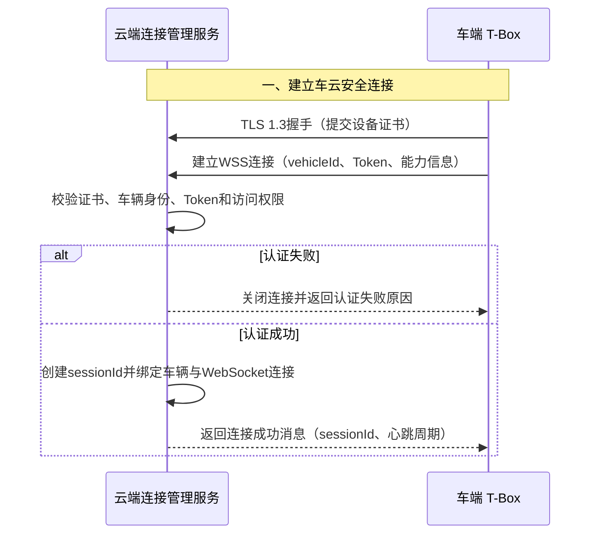
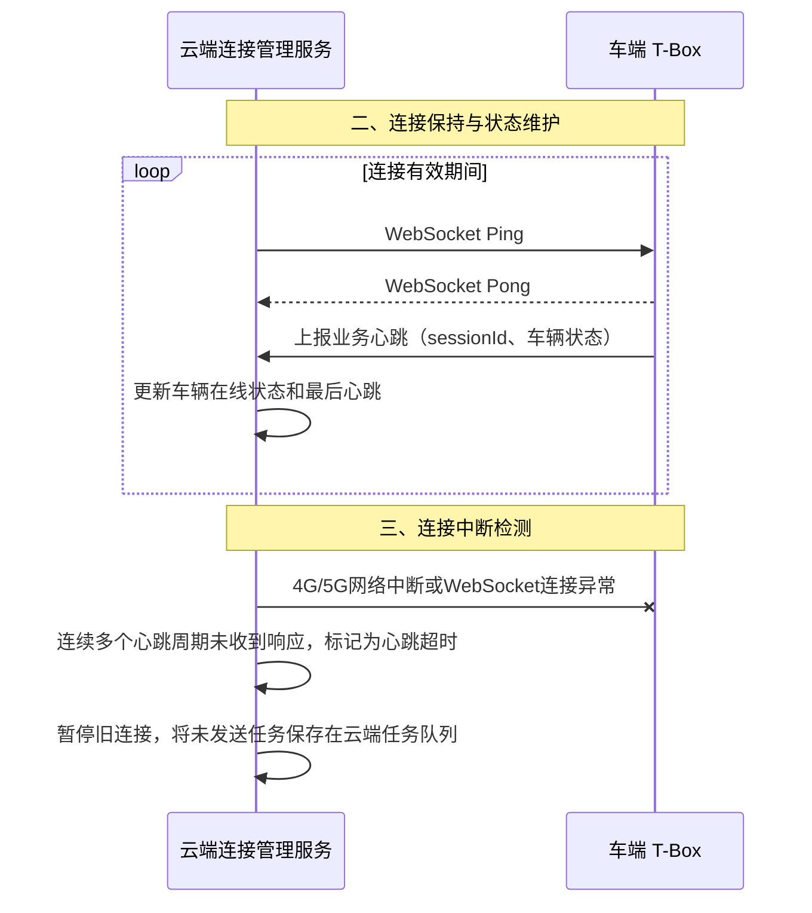
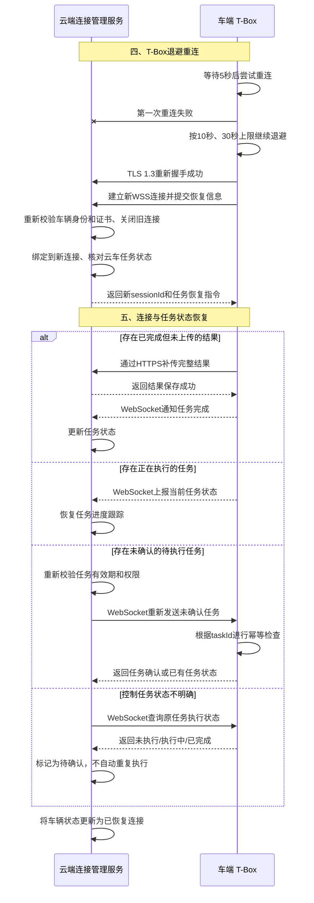

## 方案：WebSocket＋HTTPS

### 方案说明

- T-Box主动建立WSS长连接，云端和T-Box通过同一连接双向发送消息。
- 云端请求封装成WebSocket消息
- T-Box解析任务，将返回结果封装成WebSocket消息返回云

### 优点

- WebSocket原生双向通信，云端实时下发诊断、控制任务
- 任务、确认、进度和小型结果可以通过同一连接传输
- 不需要单独部署MQTT Broker

### 缺点

- 无MQTT原生的QoS、持久会话和离线消息能力
- 消息确认、重试、超时、幂等和任务补偿需要应用层自行实现
- 车辆数量增加后需要建设WebSocket连接集群、会话路由和负载均衡
- 服务节点故障后，车辆需要重新连接并恢复会话
