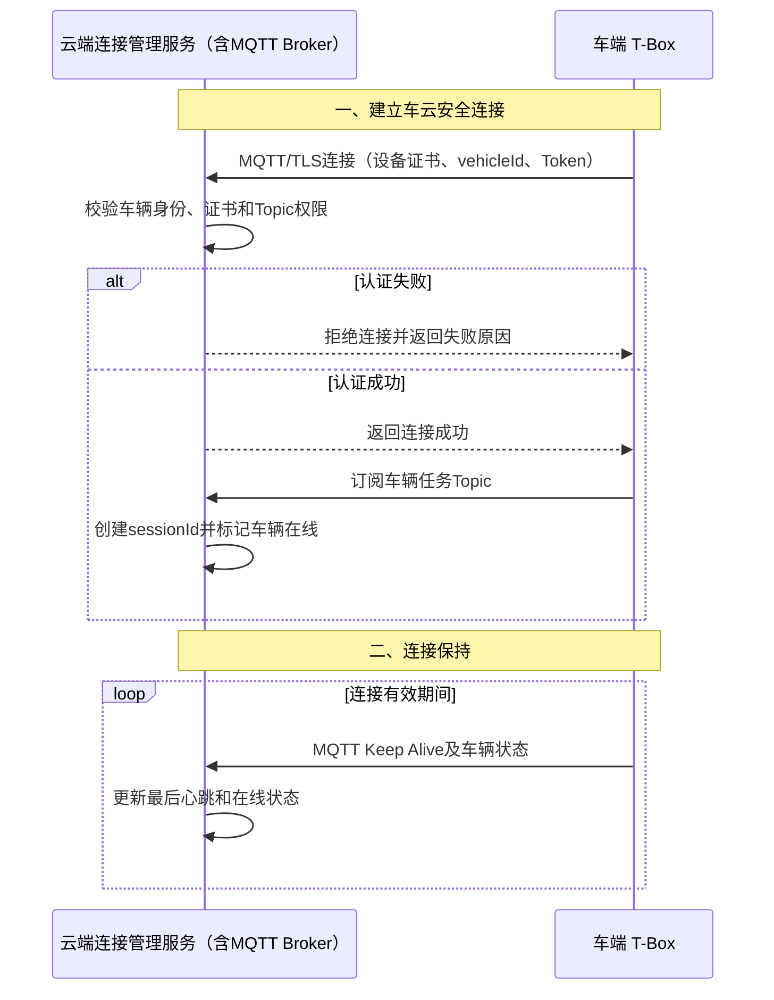
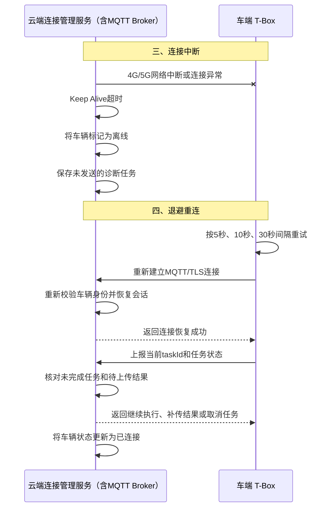
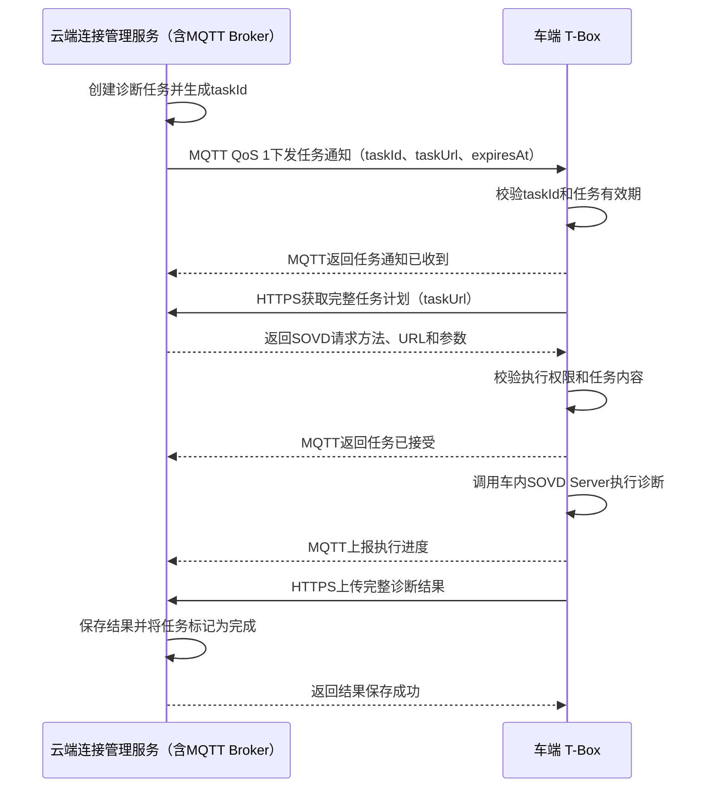

## 方案：MQTT＋HTTPS

### 方案说明

- T-Box主动与云MQTT Broker建立长连接。
- MQTT负责车辆上线、连接保持、诊断任务通知、业务确认、执行进度和完成通知。
- HTTPS负责获取完整任务计划，以及上传完整诊断结果、日志和大型文件。
- MQTT Broker部署在云端，负责车辆连接、Topic路由、QoS投递和会话管理。
- T-Box中设置SOVD Gateway模块，负责MQTT连接、任务解析、SOVD请求转换、结果上传和断线恢复。

#### 优点

- 保留MQTT在弱网、心跳和长连接方面的优势。
- **大规模和弱网能力最好**
- HTTPS上传成功后直接完成任务，减少重复完成通知。
- 后续仍可扩展为更完整的Topic和任务恢复机制。
- **强调弱网、离线消息和规模扩展**

#### 不足

- **需在云端部署MQTT Broker。**
- **需要同时开发MQTT任务消息和HTTPS结果接口。**
- SOVD请求需要封装成MQTT任务。
- 诊断任务参数过大时，仍需改为通过HTTPS获取。
