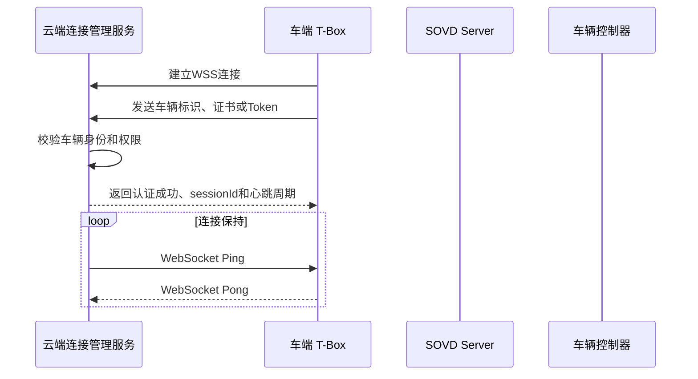
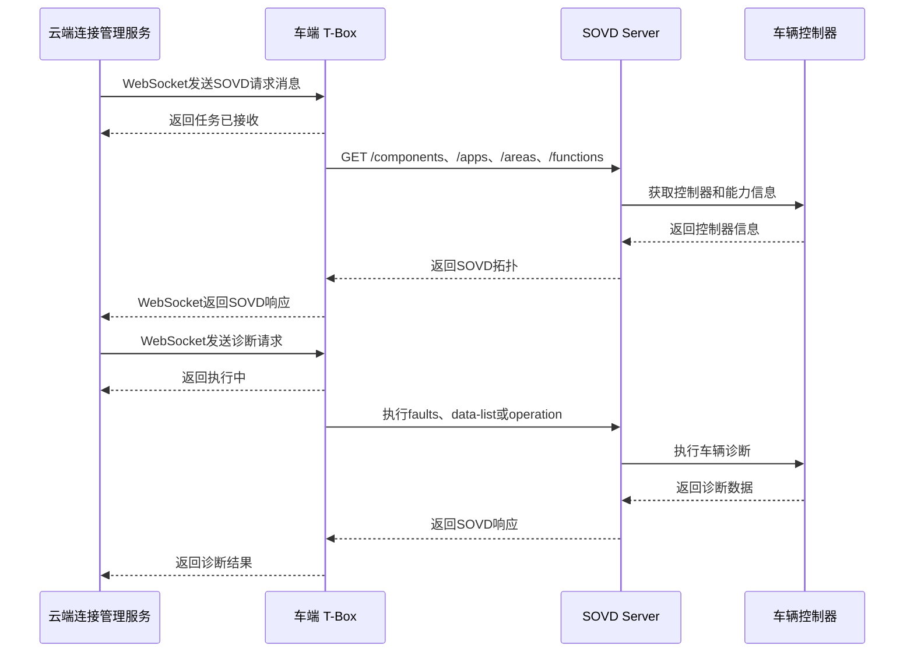
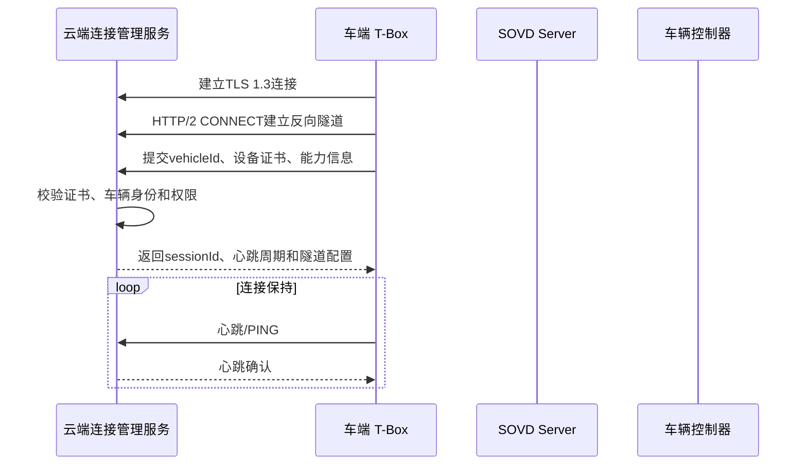
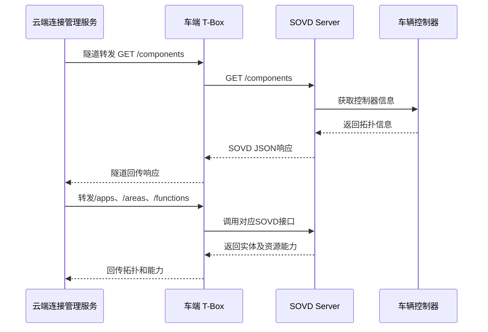
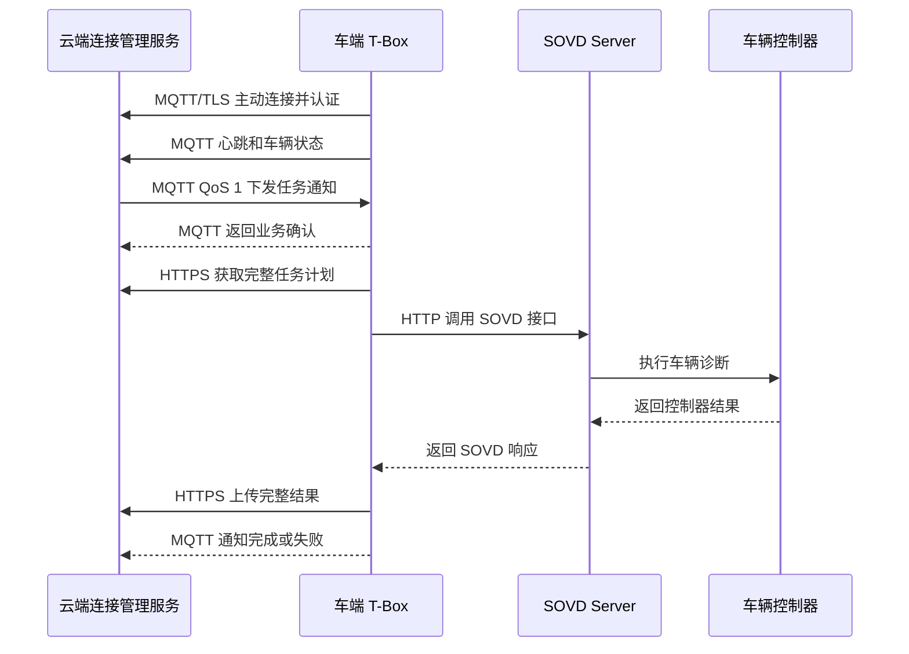

# SOVD 车云连接方案

## 角色

| 角色 | 主要职责 |
| --- | --- |
| **云端诊断页面** | 选择车辆、获取拓扑、配置诊断、下发任务、展示进度与结果 |
| **云端连接管理服务** | 车辆认证、在线会话、请求路由、任务管理、结果存储和状态推送 |
| **车端 T-Box** | 主动连云、维护连接、接收请求、执行安全校验、访问车内 SOVD Server |
| SOVD Server | 提供拓扑、资源能力和诊断接口，将请求转换为车内诊断操作 |
| 车辆控制器 | 执行实际的数据读取、故障读取和操作控制 |


## 方案1：websocket＋HTTPS

### 1 方案说明

T-Box主动建立WSS长连接，云端和T-Box通过同一连接双向发送消息。

云端请求封装成WebSocket消息

T-Box解析后调用车内SOVD Server

收到返回结果封装成WebSocket消息返回云

### 2 交互






## 方案2：HTTP/2 反向诊断通道

### 1 方案说明

T-Box 通过 4G/5G 网络主动与云端建立 TLS 1.3＋HTTP/2 双向诊断通道。云端通过该通道转发给车端 T-Box；

T-Box 再访问车内 SOVD Server，并通过原通道返回响应。

 T-Box 中设置 SOVD Gateway 模块，连接、转发

### 2 连接与保持




### 3 诊断

诊断必须先发现车辆当前 SOVD 拓扑，再确定诊断范围。




### 4 优点

- **保留 HTTP 方法、SOVD URL、请求体和响应状态，符合 SOVD 的 REST 接口形式。**
- HTTP/2 多路复用支持在一条车云连接上并发处理多个逻辑请求。

### 5 不足

- 需要实现 HTTP/2 反向通道的会话路由、访问控制和运行监控。
- **心跳、断线重连、会话恢复、离线任务和请求幂等需要业务层设计。**
- 大型升级包和 Bulk Data 不宜长期占用诊断隧道，需要独立 HTTPS 上传或下载。


## 方案3：MQTT＋HTTPS

### 1 方案说明

```text
MQTT：连接状态、心跳、任务通知、确认、进度、完成通知
HTTPS：任务详情、拓扑、完整 SOVD 响应、日志和文件
```

### 2 交互



### 3 优点

- **MQTT 适合车辆长期在线和 4G/5G 弱网环境。**
- **任务通知与大型数据分离，适合大量车辆在线和后续规模扩大。**
- 容易扩展远程控制、升级通知和其他异步车云消息。

### 4 不足

- 需要同时**建设 MQTT Broker、消息接口和 HTTPS 数据接口。**
- SOVD HTTP **请求需要封装成诊断任务，不能直接透明转发 URL**。
- 需要T-Box 支持 MQTT 协议。


## 方案对比

|                      | HTTP/2反向诊断通道             | WebSocket＋HTTPS                      | MQTT＋HTTPS                         |
| -------------------- | ------------------------------ | ------------------------------------- | ----------------------------------- |
| **云端主动发起诊断** | 通过隧道转发HTTP/SOVD请求      | 通过WebSocket下发诊断消息             | 通过MQTT下发任务通知                |
| **SOVD接口适配**     | 原生HTTP语义，适配好           | 需要封装成消息                        | 需要封装为任务模型                  |
| **早期原型开发**     | 需实现反向通道                 | 三种方案中相对容易                    | 需要同时开发MQTT和HTTP              |
| **车辆规模**         | 适合中小规模                   | 适合中小规模                          | 适合更大规模                        |
| 开发复杂度           | 中                             | 中                                    | 中高                                |
| 主要优势             | SOVD请求透明调试直观           | 双向交互直观、实现相对简单            | 弱网可靠性和规模扩展较好            |
| **主要不足**         | 通道、重连和安全代理需自行建设 | 无原生QoS和离线消息，可靠性机制需自建 | 需要在云端部署和运维**MQTT Broker** |
| 综合判断             | SOVD适配最好                   | 实现难度与双向能力最均衡              | 大规模和弱网能力最好                |


## 只有SSE场景明确需要保持连接

SOVD对以下场景使用Server-Sent Events：

- `cyclic-subscriptions`周期数据；
- `triggers`触发事件；
- 持续返回增量诊断数据。


**断连后恢复**

**大规模车辆连接问题**

**车云连接受影响业务背景 连接保持场景 什么情况连接断线** 

连接建立

远程诊断

数据上报
